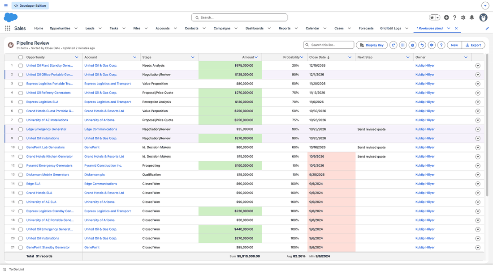

# Rowhouse by Kugamon

_The grid Salesforce should have shipped._

[Website](https://rowhouse.app) | [Contributing](CONTRIBUTING.md) | [Support](SUPPORT.md) | [Security](SECURITY.md)

[](https://github.com/kugamon/rowhouse/actions/workflows/ci.yml)
[](LICENSE)

A free, open-source data grid for Salesforce, built as a Lightning Web
Component. Users edit records in place with spreadsheet keys, group and total
them, open related records under each row, import and export, and run actions,
from the keyboard as well as the mouse, built for screen readers. Admins build
each grid on a Grid Admin tab, without code. There is no paid tier. It runs
in Lightning Experience, in the browsers Salesforce supports.



## Install

Rowhouse 1.3, **Winter 2027**, is a managed package (namespace `rowhouse`,
package version ID `04tUK000000UDSrYAO`).

- **Production or Developer Edition org:**
  [install Rowhouse](https://login.salesforce.com/packaging/installPackage.apexp?p0=04tUK000000UDSrYAO)
- **Sandbox:**
  [install Rowhouse in a sandbox](https://test.salesforce.com/packaging/installPackage.apexp?p0=04tUK000000UDSrYAO)
- **Salesforce CLI:**
  `sf package install --package 04tUK000000UDSrYAO --target-org <your org> --wait 20`

Then assign the **Rowhouse Grid Admin** permission set to whoever builds grids
and **Rowhouse Grid User** to everyone who uses them, and open the **Rowhouse**
app from the App Launcher: its Grid Guide tab walks you through your first
grid ([Placing a grid](#placing-a-grid), below).

- **Upgrading:** each new version is installed the same way, from its link in
  [CHANGELOG.md](CHANGELOG.md). It upgrades Rowhouse in place and keeps your
  grids. **Check for a newer version**, under the Grid Admin tab's name, opens
  rowhouse.app's What's new with your version, which says whether a newer one
  is out.
- **If saving a grid is refused** with "Salesforce did not let Rowhouse save
  it", turn on **Deploy Metadata from Non-Certified Package Versions via
  Apex** (in Setup, type Apex Settings in the Quick Find box). Saving a grid,
  the Grid Guide's Build buttons and Import Grid write Custom Metadata from
  Apex, and Salesforce documents this setting for a package that has not yet
  passed its security review. The orgs Rowhouse has been tried in, a
  production org among them, saved with it off, so leave it off unless your
  org refuses.

## What it does

**Editing**
- Inline edit: type on a cell, or press Enter or F2, or double-click. Required
  fields are checked in the editor, and save errors show on the cell.
- Editors for every common field type: text, number, currency and percent,
  date (with its calendar), date/time (in the user's time zone), time,
  checkbox, picklist, dependent picklist, multi-select picklist, lookup and
  owner (search as you type, honoring the field's lookup filter, with New
  record), and long text.
- Spreadsheet feel: cell ranges, copy and paste with Excel and Google Sheets,
  fill down, clear, undo and redo of unsaved edits, frozen columns
  ([docs/spreadsheet.md](docs/spreadsheet.md)).
- Saves are validated first, then written in chunks of 200 rows, with the
  results reported per row.

**Seeing the data**
- Multi-column sort, quick search, and filters: the admin's, which users
  cannot remove, and each user's own from a column's menu.
- Grouping up to three levels (dates by day, week, month, quarter, year or
  fiscal period), with counts and subtotals over every matching record, and a
  Total row.
- Charts beside the grid, as on a list view: a bar, stacked bar or donut
  chart of a record count, sum or average by any column the grid can group
  by, over every matching record, with a tooltip on each bar, kept in each
  user's layout.
- Child tables: a row opens tabs of related records, each a grid of its own,
  up to three levels deep, with child-total columns on the parent.
- Formula columns in the syntax of formula fields, and display rules: fills,
  text colors, bold, a colored bar per row, icons and data bars, explained in
  a Display Key.
- More rows load as you scroll, up to 100,000. Search always runs on the
  server; past 10,000 rows, so does sorting. An object with more records than
  that still opens, with its full count; search and filters reach the rest.
- Each user's own layout, kept in Salesforce: widths, wrapping, sort,
  grouping, and which columns show, in which order.
- A list view's look, with its row numbers (an admin can hide them), and a
  card layout on narrow screens.
- Orgs with more than one currency: each amount in its record's own
  currency, shown by its code as Salesforce shows it, and totals in the
  corporate currency, labelled as such.

**Working in bulk**
- Select rows to update a field on all of them, or delete them (when the
  grid allows it), with Undo.
- Import from CSV or Excel: a preview first, then updates by record Id or an
  External Id and new records for the rest, with Undo import.
- Export every matching record as Salesforce exports a report: a Formatted
  Report (Excel, as the grid looks, under the report's header and filter
  details, groups with subtotals) or Details Only (Excel or CSV, lookups by
  name, formula injection neutralized); optionally only for users with the
  Export Reports permission.
- Actions from each row's menu or on the selected rows: a screen flow or an
  autolaunched flow (which can call your Apex), and from a row's menu a quick
  action, in Salesforce's own window.

**For admins**
- The Grid Admin tab: every grid, searchable, sortable, and listed by object
  or as archived; build, change, clone and archive grids without Setup. A gear
  on each grid opens its settings in place.
- An optional audit trail: one Grid Edit Log entry per change, written with
  the change or not at all, kept forever or for a period you choose.
- The Grid Guide tab: the full documentation inside Salesforce, with
  tutorials, and a ? on every grid that opens the matching page.

**Built in**
- Every read and write runs as the user, through Salesforce's own object,
  field and sharing security. No callouts, no third-party JavaScript.
- A keyboard model and ARIA grid semantics throughout, checked by an
  automated accessibility suite and a manual screen-reader pass.
- Works under Lightning Web Security and under Lightning Locker.
- Benchmarks from 1,000 to 110,000 rows: [docs/benchmarks.md](docs/benchmarks.md).

## Placing a grid

The quickest way: assign yourself the **Rowhouse Grid Admin** permission set
(as well as **Rowhouse Grid User**), open the **Rowhouse** app from the App
Launcher (it opens on the **Grid Guide** tab; click **Grid Admin**), and use
**New grid**: choose the object, then the columns, display rules, filters,
actions and child tables, and save. Saving deploys the configuration, so it
also needs Customize Application, which Salesforce admins have. The Grid
Guide's Get started page walks through it.

To build a grid in Setup instead:

1. Create a **Grid Configuration** custom metadata record (the object, page
   size, default sort and, if you want them, frozen columns and a height), and
   a **Grid Column** record for each column. Add **Grid Display Rule** records
   for display rules, **Grid Filter** records for conditions every row must
   meet, **Grid Action** records for actions and **Grid Child Table** records
   for child tables. The Grid Guide's Configuration reference describes every
   field.
2. In Lightning App Builder, drag **Rowhouse Grid** onto an App, Record or Home
   page and enter the configuration's API name in **Grid Configuration**. On
   a record page the grid is given the page's record by Lightning; there is
   nothing more to set.
3. Assign the **Rowhouse Grid User** permission set to the people who use it.
   It also lets them write the audit log and read their own entries. To let
   someone read everyone's entries, give them View All on Grid Edit Log in a
   permission set of your own.

## Repo layout

```
force-app/main/default/
  lwc/
    gridApp/          the component an admin places; hosts one gridView
    gridView/         one grid: loads, saves, exports; a child table is one too
    gridTable/        the table: rendering, keyboard, ARIA, windowing, cards
    gridChildTabs/     an open row's tabs of child tables
    gridChildTables/         child tables: panel rows, heights by level, row offsets
    gridKeyboard/     keyboard model as pure functions (no DOM)
    gridFormat/       display, rounding, comparison and link-safety rules
    gridCsv/          CSV export, and handing an exported file to the browser
    gridExportDialog/ the Export dialog: Formatted Report or Details Only
    gridExcel/        Export: a Formatted Report and Details Only, as sheets
    gridXlsxWriter/   our own .xlsx writer: ZIP, DEFLATE, the sheet and its styles
    gridEditState/    draft edits and save results
    gridClipboard/    what copy writes and paste reads, per column type
    gridHistory/      undo and redo of unsaved edits
    gridPendingLayout/ a layout change held in the browser until it is kept
    gridFields/       lookup names and links, picklist dependencies
    gridDisplayRules/  display rules: which cells a rule colors
    gridUpdateField/   the dialog that changes one field on the selected rows
    gridImport/       CSV reading and the import plan: what each row will do
    gridXlsx/         our own .xlsx reader: unzip, inflate, worksheets
    gridImportDialog/ the import dialog: file, preview, batches, result
    gridActionDialog/ an action's dialog: asks before a server action runs
    gridFlowRoute/    hands a screen flow to its own page and back
    rowhouseFlow/     the page a screen-flow action runs on
    gridGuide/    the Grid Guide tab: the documentation
    guidePage*/       its pages, built from guide/pages; do not edit
    guideContent/     which page to show (built); guideCatalog/ the page list (built)
    guidePageBase/    what every page does: links, sections, copy buttons
    guideRoute/       addresses of the guide's pages, and opening it in a new tab
    guideStyles/      the guide's one stylesheet, in Salesforce's look
    gridGroups/       grouping: keys, group rows, subtotals added up
    gridTiming/       benchmark timings, only with diagnostics on
    gridAdmin/    the Grid Admin tab: every grid, and its editor
    gridAdminRowDialog/ a grid's Clone, Archive, Restore and Delete in Setup
    gridConfigEditor/ a grid's settings: columns, rules, actions, child tables
    gridSettings/     the dialog a grid's gear opens
    gridAdminDraft/   the settings editor's plain logic
    cell*/            the cell editors
  classes/            Apex: GridSecurity, GridDescribe, GridDataService,
                      GridConfig, GridSaveService, GridDeleteService,
                      GridImportService, GridGroupService, GridLookup,
                      GridChildTables, GridActions, GridActionService,
                      GridEditLog, GridController, GridAdmin,
                      GridAdminController, ...
  objects/            configuration metadata types, the save-results object
                      and the audit log (Grid Edit Log)
  layouts/            their record pages in Setup, every field shown
  permissionsets/     Rowhouse Grid User, Diagnostics and Admin
  customPermissions/  Rowhouse_Grid_Diagnostics, Rowhouse_Grid_Admin
  staticresources/    the Rowhouse by Kugamon logo and mark; a tutorial's attendees file
  contentassets/      the Rowhouse app's logo
  applications/       the Rowhouse app: Grid Guide, Grid Admin, Grid Edit Logs
  tabs/               the Grid Admin, Grid Edit Logs and Grid Guide tabs
guide/                the Grid Guide's pages (HTML) and build.js, which makes them components
test-data/            test objects, sample configurations, seed data, test suites
dev/                  development-only metadata, never packaged
eslint-rules/         custom lint rules that enforce the hard rules
scripts/checks/       hard-rule checks run before every commit and in CI
docs/                 benchmarks, the spreadsheet keys, the logo files and README images
```

## Running the checks

```bash
npm ci --legacy-peer-deps
npm run verify    # self-tests, hard-rule checks, formatting, ESLint, SLDS Linter, Jest
```

The same command runs in CI on every push and pull request. The Apex suite runs
in a Salesforce org; see [CONTRIBUTING.md](CONTRIBUTING.md).

## Documents

- The Grid Guide, inside Salesforce (the Grid Guide tab); its pages are in
  [`guide/pages`](guide/pages). Change a page, then run `npm run guide`.
- [CHANGELOG.md](CHANGELOG.md): each release, with its install links.
- [CONTRIBUTING.md](CONTRIBUTING.md): set-up, what a change must include, and
  the twenty-nine hard rules.
- [SUPPORT.md](SUPPORT.md): how to get help and report a bug.
- [SECURITY.md](SECURITY.md): how to report a vulnerability privately, and
  how Rowhouse by Kugamon protects data.
- [CODE_OF_CONDUCT.md](CODE_OF_CONDUCT.md): how we treat each other here.
- [`docs/benchmarks.md`](docs/benchmarks.md): the benchmark protocol, how to
  run it, and the results.
- [`docs/spreadsheet.md`](docs/spreadsheet.md): ranges, copy, paste, undo and
  frozen columns, and their keys.
- [`docs/brand/`](docs/brand/): the Rowhouse by Kugamon logo files.

## License

GNU Affero General Public License v3.0 (AGPL-3.0); see [LICENSE](LICENSE)
and [NOTICE](NOTICE). Installing the package and using it in your org asks
nothing of you. Change it freely too; if you distribute a changed version, or
a work based on Rowhouse, it must be under the AGPL-3.0 as well, with its
source; and if you let people use a changed version over a network, offer
them its source (section 13 of the license). The name is covered by the
[trademark policy](TRADEMARKS.md).

Rowhouse by Kugamon is an independent open-source project. It is not affiliated with,
endorsed by or sponsored by Salesforce, Inc. Salesforce, Lightning and
AppExchange are trademarks of Salesforce, Inc. “Rowhouse” and the Rowhouse
logo are trademarks of Kugamon LLC.
