# Rowhouse — the mark

> The technical reference for the Rowhouse by Kugamon logo files.



**A gable roof over three rows. The middle row is the one being edited.**

The roof sits apart from the rows rather than enclosing them, so the mark reads
as two things held together rather than one solid block: a house above, data
below. Three separate bars with rounded ends read as rows in a table, and the
middle one in clay is the row under the cursor.

## Files

| File | Use |
|---|---|
| `logo/rowhouse-mark.svg` | **Primary.** Pine with the live row in clay. Default for anything above 20px. |
| `logo/rowhouse-mark-mono.svg` | One color. Takes `currentColor`, so it inherits the text color around it. |
| `logo/rowhouse-mark-reversed.svg` | For pine, ink or photographic grounds. |
| `logo/rowhouse-favicon.svg` | **A different drawing**, not a scaled copy — same three bars, but redrawn so every edge except the roof diagonals lands on a whole pixel. Use below 20px. |
| `logo/rowhouse-app-icon.svg` | **Primary icon.** 64pt rounded tile, mark reversed out of pine, 66% optical inset. |
| `logo/rowhouse-app-icon-light.svg` | **Alternate icon.** The same tile and the same inset, with the mark in its own colors on `accent-soft`. For light home screens, light-mode docs and anywhere the pine tile goes heavy. Also the Salesforce app image, drawn at 256 pixels and shipped as `RowhouseAppIconLight` in `force-app/main/default/contentassets/`; replace it if this file changes. |
| `logo/rowhouse-lockup.svg` | Horizontal mark + wordmark. The usual choice for a site header or a README. |
| `logo/rowhouse-lockup-stacked.svg` | Stacked, for square spaces. |
| `logo/rowhouse-lockup-reversed.svg` | Horizontal, for dark grounds. |

## Geometry

Drawn on a 32-unit grid. The mark occupies x 2–30, y 3.5–30.

```
roof          x 2–30, apex at x 16 y 3.5, eaves y 11.5
bars          x 2, width 28, height 4, corner radius 1
bar positions y 14 · 20 · 26      gap 2 between bars
gap to roof   2.5                 eaves y11.5 to first bar y14
```

The roof spans exactly the same width as the bars, so the mark has one
consistent measure. The bars sit on even numbers; the roof diagonals cannot,
which is one reason the favicon is drawn separately.

**Do not redraw it.** If you need a size that is not here, scale the SVG.

## Color

| Role | Token | Hex |
|---|---|---|
| Roof and outer bars | `--accent` | `#0F5C45` pine |
| Live row | `--signal` | `#B3431F` clay |
| Reversed roof and bars | `--ground` | `#FCFBF8` paper |
| Reversed live row | `--accent-mid` | `#8FC4AE` |

The clay is used **once**, on the middle bar, and nowhere else in the mark.
That restraint is what makes it read as a highlight rather than decoration.

The mark in the site navigation is inline SVG filled with `var(--accent)` and
`var(--signal)`, so it re-themes itself in dark mode along with everything else.

## The two app icons

They are the same drawing on the same tile — `rx 14`, `translate(10.5 10.5)
scale(1.344)` — so they are interchangeable and sit together without adjustment.
Only the colors differ.

| | Tile | Roof and outer bars | Live row |
|---|---|---|---|
| Primary | `accent` pine | `ground` paper, 7.70:1 | `accent-mid`, **4.05:1** |
| Alternate | `accent-soft` | `accent` pine, 6.72:1 | `signal` clay, **4.74:1** |

Two things are worth knowing about why the alternate is drawn this way.

**It is the only icon that carries the clay.** Reversing the mark out of pine
costs you the signal color — clay on pine is 1.42:1, so the reversed mark uses
`accent-mid` for the middle bar instead. At 40px that reads as a *faded* row
rather than a *highlighted* one, which is backwards: the middle bar is supposed
to be the row you are working in. On a pale tile the clay comes back at full
strength and the live row becomes the strongest thing in the icon, which is what
it should have been all along.

**The tile is `accent-soft`, not paper.** Paper was the obvious choice and it
fails the only test that matters: `#FCFBF8` against a white background is 1.03:1,
so at 40px on a white home screen or a light documentation page the tile vanishes
and the mark floats with no house around it. A hairline border does not rescue it
— at that size the border is a grey smudge in the corners and the gaps between
the bars still go white, so the bars stop reading as rows. `accent-soft` holds its
own edge at every size without a stroke, which also keeps the mark flat.

**The alternate is the Salesforce app image.** In the App Launcher's white list the pale
tile reads as an app tile and the clay row shows at full strength.

## Clear space and minimum size

- **Clear space:** one bar height — 4 units, or 14% of the mark's width — on
  every side. Nothing intrudes.
- **Minimum size:** mark 16px or 6mm; lockup 110px or 28mm.
- **Below 20px, switch to the favicon drawing.** At that size the three thin
  bars and the gaps between them smear; the favicon is redrawn on the pixel
  grid so they stay separate.

## Don't

- Don't recolor outside pine, ink, paper and the reversed pair.
- Don't put the clay on any bar but the middle one. It means "the row you are
  editing"; moving it makes it meaningless.
- Don't add a stroke, a shadow, a gradient or a bevel. The mark is flat.
- Don't stretch it. Scale both axes together.
- Don't set the wordmark in another typeface, another case or another weight.
  It is **Montserrat Regular (400), all caps, tracked**. Never bold.
- Don't place the mark on a busy photograph without the reversed version and
  adequate contrast.

## The wordmark is live text

The lockups keep `ROWHOUSE` as real `<text>`, not outlines, so it stays
selectable, searchable and translatable. It is set in **Montserrat Regular
(400), all caps**, tracked 2.2 units at 19pt.

`textLength` is set to Montserrat's own measured width — 137 units for the
horizontal lockup — with `lengthAdjust="spacingAndGlyphs"`. So where Montserrat
is installed nothing is distorted, and where it is not the lockup still holds
its exact proportions instead of overflowing.

**For print or for a logo registry, convert the text to outlines first** with
Montserrat actually installed — otherwise a press will substitute a font.
Montserrat is OFL-1.1, so outlining and redistributing the outlined artwork is
permitted.

## Animated versions

Eight files in `animated/` — four animations, each with a reversed twin for
dark grounds. Each is a self-contained SVG with internal CSS, so it animates as
an ``, as a CSS background, inline, or in an `<object>`. No JavaScript, no
external anything. Open `animated-preview.html` to see them.

| File | Motion | Use |
|---|---|---|
| `rowhouse-mark-cursor.svg` | The live row steps down the rows and back. Loops, 5s. | **The signature.** Site hero, social card, anywhere the mark has room to be itself. |
| `rowhouse-mark-build.svg` | Roof settles, then rows draw in from the left. Once, 0.78s. | First paint, a splash, a README header. |
| `rowhouse-lockup-build.svg` | The build, with the wordmark arriving after. Once, 0.96s. | Site header on load. |
| `rowhouse-mark-loading.svg` | Rows fade in sequence. Loops, 1.7s. | **Site and docs only.** |

Each has a `-reversed` version for pine, ink or a photograph. **Use it.** The
light version on a pine ground loses the roof and the outer two rows entirely,
leaving a single clay bar floating on green — the whole mark gone except the
one element that happens to contrast.

The reversed loading file fades to `.42` rather than `.32`. On a dark ground
the lower floor sinks the rows into the background instead of fading them.

### Two rules every one of them keeps

**They rest in the real logo.** A renderer that ignores animation — a PDF, a
thumbnailer, an email client, an old browser — still shows the correct static
mark. This is verified, not assumed: each file is rendered with animation
disabled and compared pixel-for-pixel against `rowhouse-mark.svg` at 512px.
All four are identical.

**They stop on `prefers-reduced-motion`.** Not slowed, stopped. Given that the
whole architectural case for building our own table was accessibility, an
animated logo that ignores the setting would be an embarrassing place to fail.

### Why the cursor animates `fill` rather than sliding a bar

The obvious build is a clay bar that slides between the three rows. It leaves
an artefact at every anti-aliased edge, and the fix is not obvious:

- Laid **on top** of a pine bar, the pine shows through the clay bar's rounded
  corners as a dark fringe.
- Masked with a hole **the same size**, the pine survives at coverage
  `a × (1−a)` — about 25% halfway across an edge pixel. Still a fringe.
- Masked with a hole **bled wider**, the fringe goes pale instead of dark,
  because background shows where the pine was removed and the clay does not
  reach.

Animating `fill` moves no geometry at all, so there is nothing to composite and
nothing to go wrong at any size. It is also truer to the thing it depicts: a
cursor in a grid jumps from row to row, it does not glide.

### Not for in-product loading

`rowhouse-mark-loading.svg` is for the marketing and documentation sites. The
product's own spinners match Salesforce's standard spinner in color and size:
a branded spinner inside the grid would look out of place.

### On a site

```html
<!-- plays once on load, then rests -->

```

For a nav mark that animates only on hover, use the static mark and move the
highlight in your own CSS — don't load the looping file into a 19px slot and
leave it running on every page.


## Trademark

The software is AGPL-3.0. **The mark and the name are not.** The NOTICE
file declines trademark rights under AGPL-3.0 §7(e). See `TRADEMARKS.md` in the repository for what a
fork may and may not call itself.
